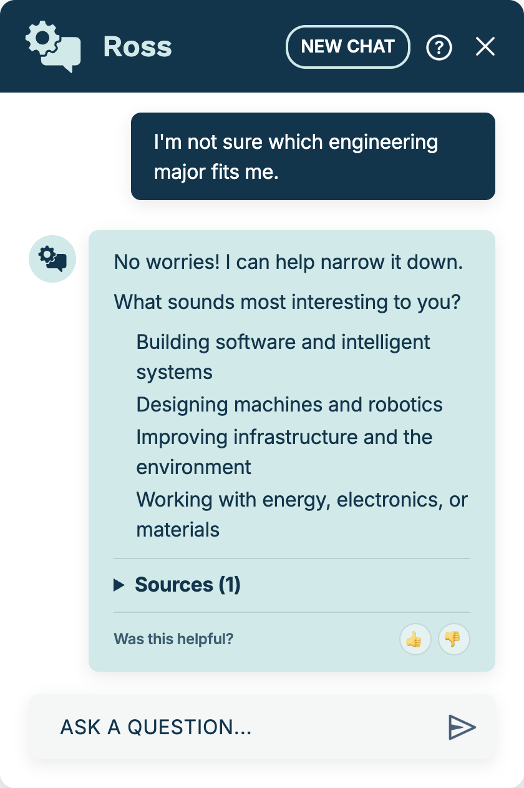
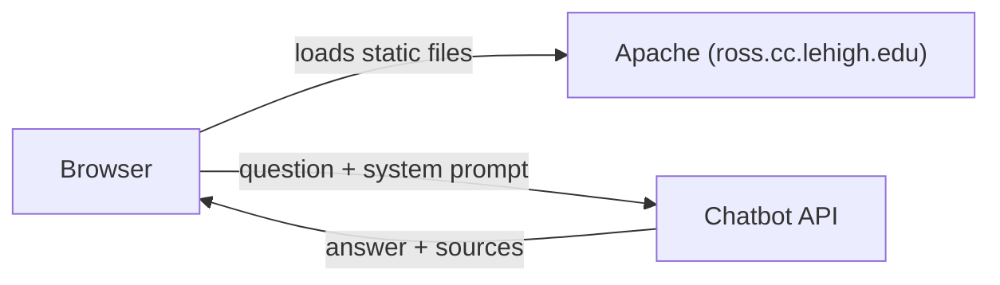

# Ross

Ross is a virtual ambassador for Lehigh University's P.C. Rossin College of
Engineering and Applied Science. It helps prospective students explore the
college and links each answer to its sources. It is live at
<https://ross.cc.lehigh.edu/>.

This repository holds the web frontend, the system prompt, and the handoff
material for deploying them. The chatbot backend is run by the school's platform
and is not in this repository. Chris Larkin sponsors the project, which was
previously called LE-Chat.



*The current interface running locally with demo replies, so the answer shown is
canned text and not model output.*

If you are here to deploy Ross, go to the
[handoff README](christopher-handoff/README.md).

## How it works



Apache only serves files. The browser calls the chatbot API directly, so the
API's CORS policy has to allow the site's origin.

We maintain the frontend, the system prompt, the source list, and the test
questions. Christopher and the school platform manage the backend, retrieval,
model, bot registration, CORS, authentication, rate limits, logging, and
deployment policy. We treat the API as fixed: if it doesn't match what the
frontend expects, we change the frontend.

## Run it locally

You need Node 22.

```bash
cd ai-chatbot-lehigh
npm ci
cp .env.example .env
npm run dev
```

Open <http://localhost:6173> and click the Ross button in the bottom-right
corner.

With the API settings left blank, Ross answers with built-in demo replies and
sends no requests. That is enough for UI work, but it doesn't exercise the
model, retrieval, or the prompt.

To talk to the real API, set `VITE_CHAT_API_URL` and `VITE_CHAT_BOT_NAME` in
`.env` using the values Christopher confirms, then restart the dev server. If you
set only the URL, Ross reports that the chatbot identity is not configured. The
settings saved in `fetched_site/` belong to an earlier test service, so don't
copy them.

Before opening a pull request against `main`, run `npm run verify` from
`ai-chatbot-lehigh/`. It checks types, runs the contract tests, builds the site,
and checks the static output.

## Build settings

| Variable | Purpose |
| --- | --- |
| `VITE_CHAT_API_URL` | Chatbot API endpoint |
| `VITE_CHAT_BOT_NAME` | Bot name the API uses to route requests to Ross. It can differ from the name shown in the chat. |
| `VITE_BASE_PATH` | Public path of the site: `/` for `ross.cc.lehigh.edu`, or a subpath such as `/ross-test/` |

These values are compiled into the browser bundle, so they are public and
changing one means rebuilding. Never put a secret in them.

## System prompt

[`SYSTEM_PROMPT.txt`](christopher-handoff/backend-inputs/SYSTEM_PROMPT.txt) is
the single source of Ross's instructions.
[`chat-api.ts`](ai-chatbot-lehigh/app/services/chat-api.ts) imports it at build
time, so the full text ends up in the JavaScript bundle, and every question sends
it to the API as `custom_prompt`:

```json
{
  "action": "question",
  "bot_name": "<Ross bot name>",
  "custom_prompt": "<full text of SYSTEM_PROMPT.txt>",
  "httpMethod": "POST",
  "userMessage": "What undergraduate majors are offered?",
  "sessionId": "session-...",
  "questionId": "question-..."
}
```

Feedback requests don't include the prompt. The
[API contract](christopher-handoff/backend-inputs/API_CONTRACT.md) has every
request and response format.

Embedding the prompt has a few consequences:

- To change the prompt, edit the file, rebuild, and publish the new
  `build/client/`. It needs no backend change and no manual edit of generated
  JavaScript.
- Anyone can read the prompt in their browser's developer tools, so keep secrets
  and internal notes out of it.
- The prompt's SHA-256 is recorded by hand in
  [`RELEASE_MANIFEST.md`](christopher-handoff/RELEASE_MANIFEST.md). CI doesn't
  check it, so update it when the prompt changes.

To try the prompt against the real API without the UI, run the question suite
from the repository root. It sends the same prompt the frontend does:

```bash
bash scripts/run_question_suite.sh \
  --questions-file christopher-handoff/validation/test_questions.json \
  --custom-prompt-file christopher-handoff/backend-inputs/SYSTEM_PROMPT.txt \
  --bot-name "<Ross bot name>" \
  --endpoint "<Ross API endpoint>"
```

The script only tells you whether requests and responses worked. People still
read the answers and score them against the
[acceptance checklist](christopher-handoff/validation/ACCEPTANCE_CHECKLIST.md).

## Deploying to ross.cc.lehigh.edu

Merging to `main` deploys nothing. Christopher publishes each release by hand
through Apache, so the live site can lag behind `main`. We hand releases over on
the `christopher-handoff` branch and describe each one in
[`UPDATES.md`](christopher-handoff/UPDATES.md).

The site is a static single-page app with no Node process in production. To
release it:

1. Build from `christopher-handoff` with the existing API settings:

   ```bash
   git switch christopher-handoff
   git pull --ff-only origin christopher-handoff
   cd ai-chatbot-lehigh

   export VITE_CHAT_API_URL="<existing API endpoint>"
   export VITE_CHAT_BOT_NAME="<existing bot name>"
   export VITE_BASE_PATH="/"
   npm ci
   npm run verify:deployment
   ```

   `verify:deployment` checks the settings and then runs `npm run verify`.

2. Publish the complete contents of `build/client/` through Apache. Keep the
   `/index.html` fallback so direct visits and refreshes work, and keep the
   previous build for rollback.

3. Check the public site: the launcher, source links, feedback buttons, `NEW CHAT`,
   and a phone-sized viewport.

4. Run the 52-question suite shown above, review the answers against the
   acceptance checklist, and record the release in `RELEASE_MANIFEST.md`.

The [frontend README](ai-chatbot-lehigh/README.md) has the Apache configuration
and Docker instructions. The [handoff README](christopher-handoff/README.md) is
the full runbook, and
[`APACHE_STATIC_DEPLOYMENT_RULE.md`](APACHE_STATIC_DEPLOYMENT_RULE.md) lists the
deployment constraints Christopher confirmed.

## CI

All checks live in one workflow, [`ci.yml`](.github/workflows/ci.yml), with three
jobs:

| Job | Runs on | What it does |
| --- | --- | --- |
| `build` | PRs into `main`, pushes to `main` | `npm run verify` |
| `qa-script-contract` | PRs into `main`, pushes to `main` | Tests the QA scripts against a local mock server |
| `verify` | Every PR; pushes to `main`, `everett`, `consolidate-branches`, `its-*`, and `christopher-*` | `npm audit`, `npm run verify:deployment`, a check that the build is static, a preview smoke test at a subpath, and Apache Docker image smoke tests at the root and at a subpath |

CI uses placeholder API settings and never calls the real API, so a green run
means the site builds and serves correctly, not that Ross answers well. CI
doesn't deploy anything either.

To run the main checks yourself, use `npm run verify` from `ai-chatbot-lehigh/`
and `bash scripts/test_prompt_request.contract.test.sh` from the repository root.

## Repository layout

| Path | What's there |
| --- | --- |
| `ai-chatbot-lehigh/` | Frontend, contract tests, Dockerfile, and build instructions |
| `christopher-handoff/` | Handoff runbook, system prompt, source list, API contract, test questions, and acceptance checklist |
| `scripts/` | QA scripts for the prompt and question suite, plus the survey and site-fetching helpers |
| `.github/workflows/` | CI |
| `.claude/skills/` | Claude Code skills shared by the team |
| `docs/images/` | Screenshot used in this README |
| `fetched_site/` | Snapshot of an earlier shared test site. It is not a source of endpoints, bot names, or prompts. |
| `knowledge_base/` | Legacy working area. Don't ingest `sample.md`. |
